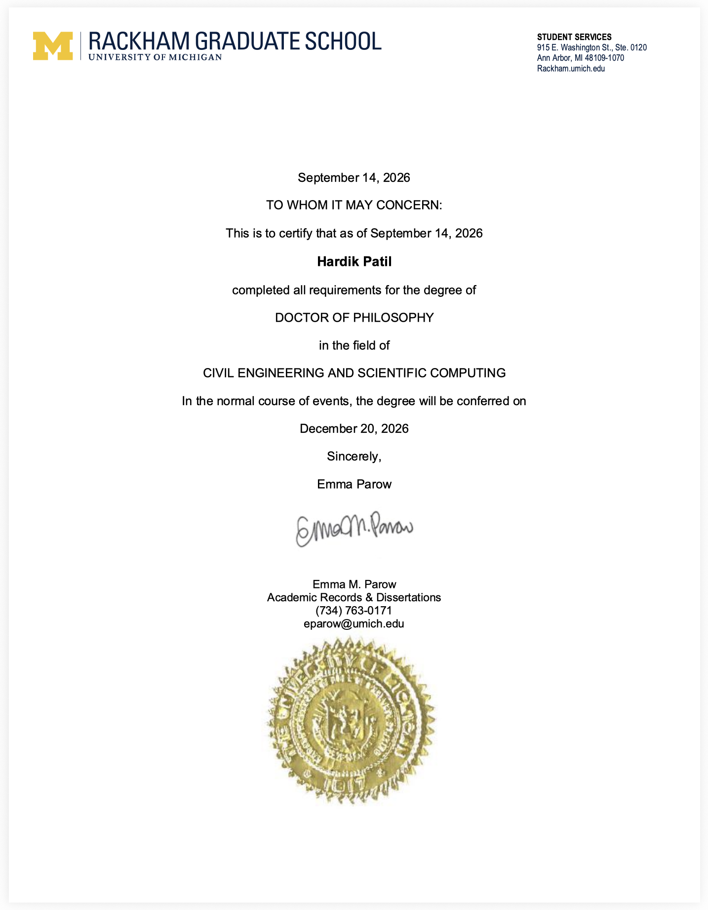

# Doctoral Dissertation at the University of Michigan

This repository contains the LaTeX files required to compile the draft of my doctoral research conducted at the University of Michigan between 2021 and 2026.

The dissertation titled **Transforming Static Structural Topologies into Functional Reconfigurable Systems** was submitted in partial fulfillment of the requirements for the degree of **Doctor of Philosophy** in *Civil Engineering and Scientific Computing* at the University of Michigan, Ann Arbor.

## ✅ Certificate of completion
